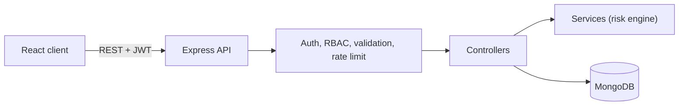
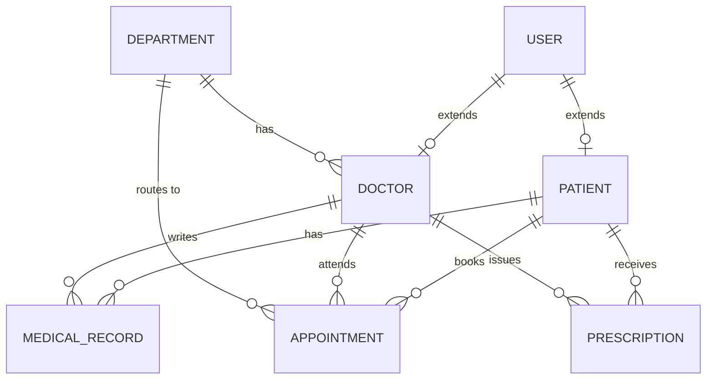

<div align="center">

# 🏥 MediPredict

### Hospital management system with role-based portals and symptom risk assessment


<!-- TODO: uncomment after deployment
[🚀 **Live Demo**](https://YOUR-DEMO-URL) · -->
[✨ Features](#-features) · [🏗️ Architecture](#️-architecture) · [⚙️ Quick Start](#️-quick-start) · [🔐 Security](#-security)

</div>

<!-- TODO: add a dashboard screenshot or GIF
<p align="center"></p>
-->

---

## 💡 Overview

MediPredict is a full-stack MERN application that digitises the core hospital workflow: patients book appointments, doctors manage consultations and prescriptions, and admins monitor the system through analytics.

## ✨ Features

| Role | What they can do |
|---|---|
| 🧑‍⚕️ **Patient** | Register, book appointments, view prescriptions and lab reports, run a symptom risk assessment |
| 👨‍⚕️ **Doctor** | Manage appointments, write prescriptions, add medical records |
| 🛠️ **Admin** | Manage users, doctors and departments, view analytics (Recharts) |

**Highlights**
- 🗓️ **Double-booking prevention** — server-side validation backed by a compound index on doctor, date and time slot
- 🖨️ **Printable digital prescriptions** and lab report tracking
- 🔐 **Role-based access control** across all routes
- 📈 **Admin analytics dashboard**

### 🧠 About the risk assessment engine

The symptom engine is **rule-based weighted scoring** (risk range 0.0–0.95), not a trained ML model. It is built as a separate service layer so a Python ML model can replace it without changing the API.

## 🏗️ Architecture





_Diagram shows the core entities; the project defines 14 Mongoose models in total._

## 🧰 Tech Stack

| Layer | Technology |
|---|---|
| Frontend | React, Recharts |
| Backend | Node.js, Express |
| Database | MongoDB (Mongoose) |
| Auth & Security | JWT, bcrypt, Helmet, rate limiting |

## ⚙️ Quick Start

```bash
# 1. Clone
git clone https://github.com/mishrapranshu9161/Medipredict.git
cd Medipredict

# 2. Backend
cd backend
npm install
cp .env.example .env      # then fill in your values
npm run dev

# 3. Frontend (new terminal)
cd frontend
npm install
npm start
```

<!-- VERIFY: folder names, .env.example, and start commands must match your repo -->

<details>
<summary><b>🔑 Demo accounts</b> (seed data only)</summary>

<br/>

<!-- Copy the demo credentials table from your old README here -->

</details>

## 🔐 Security

- Passwords hashed with **bcrypt**
- **JWT** authentication with role checks on protected routes
- **Helmet** headers and **rate limiting**
- Input validation on server-side routes

## 📁 Project Structure

<details>
<summary>Click to expand</summary>

<br/>

<!-- Paste your existing folder tree here -->

</details>

## 📚 Extra Documentation

- [Architecture & Viva Notes](docs/VIVA_GUIDE.md) — design decisions explained for academic review

## 👨‍💻 Author

**Pranshu Mishra** · B.Tech CSE, SRMU Lucknow

[](https://www.linkedin.com/in/pranshu-mishra-386873322)
[](https://github.com/mishrapranshu9161)

⭐ If you found this useful, consider giving it a star.
